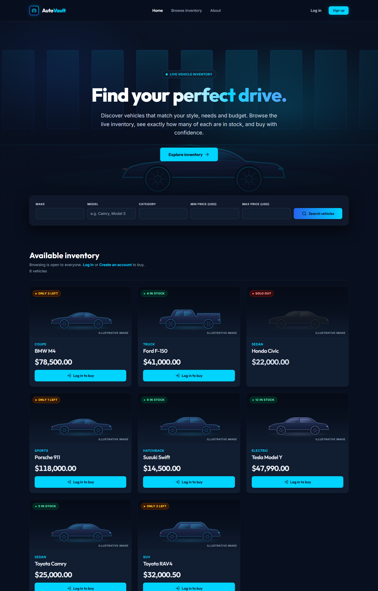
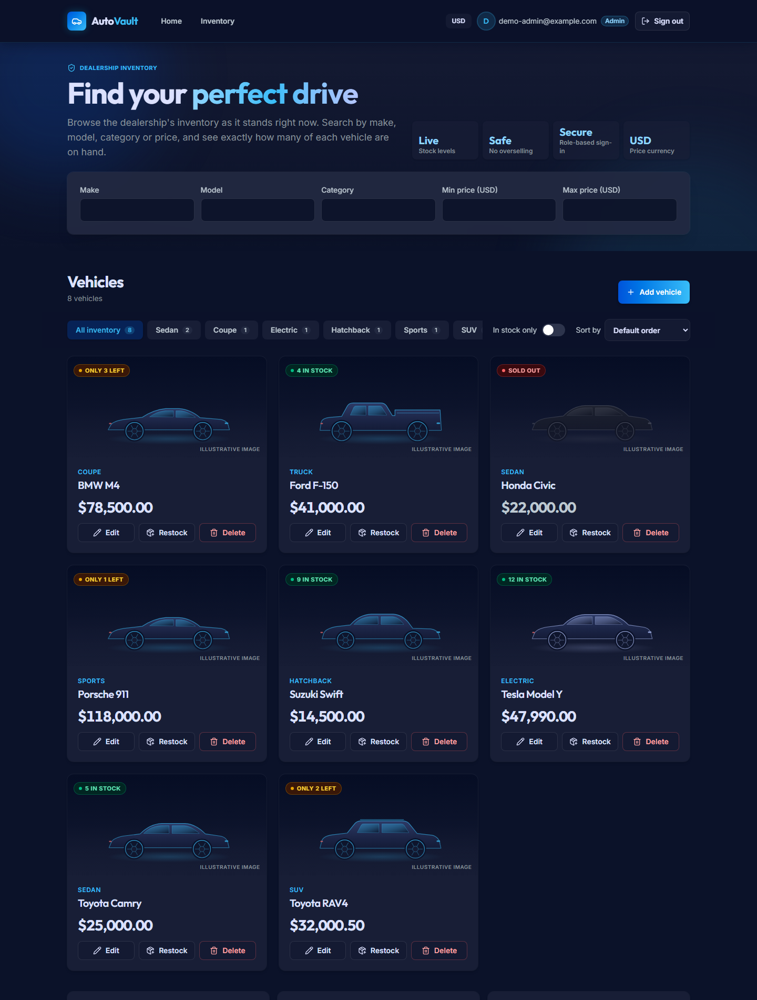
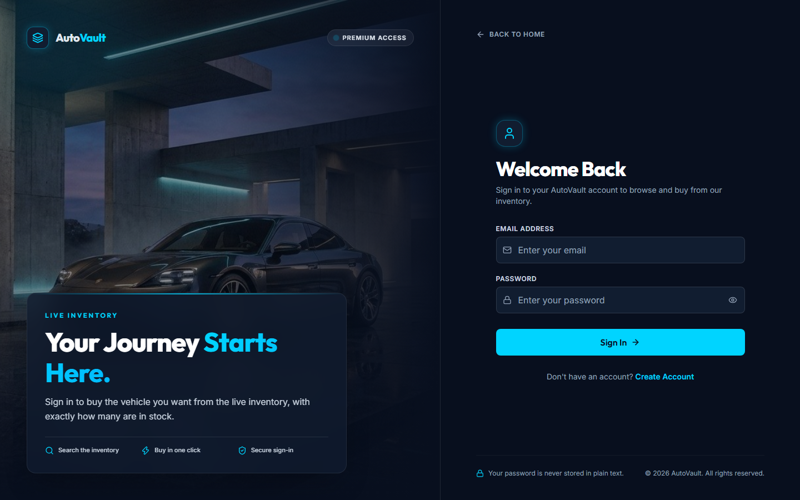
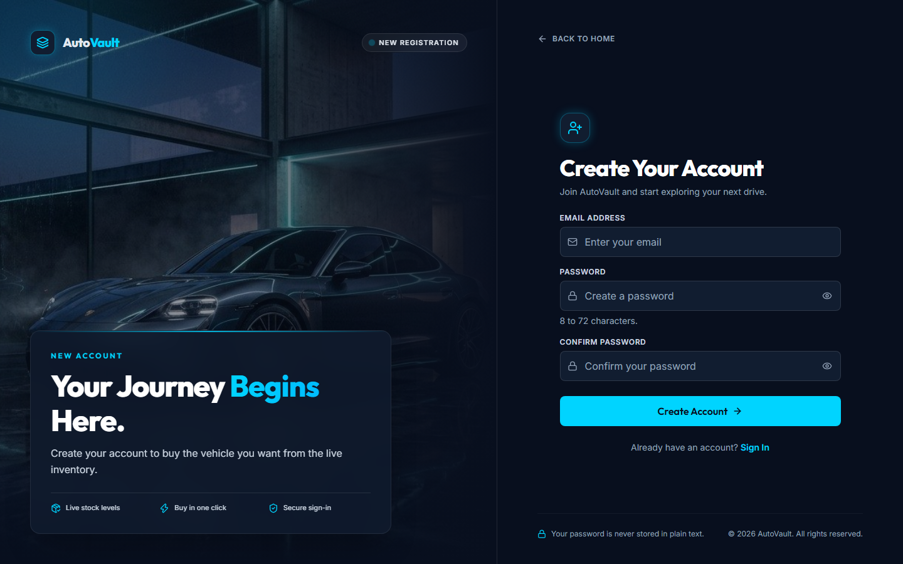
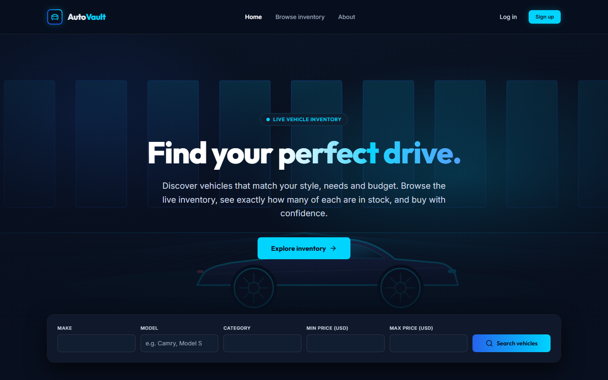
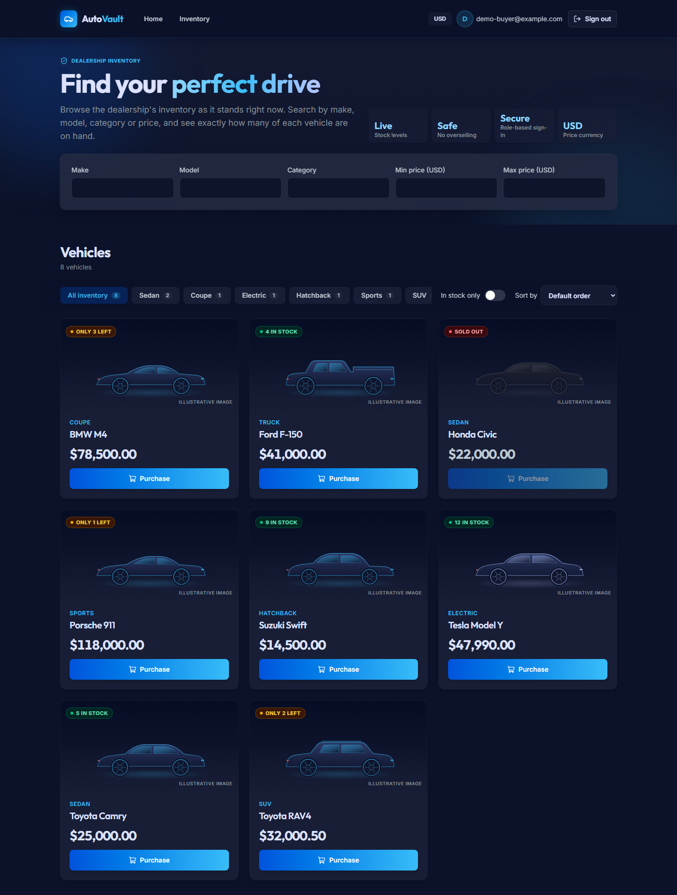

# AutoVault: Car Dealership Inventory System

A full-stack inventory system for a car dealership. Visitors can browse and search the stock without an account;
signed-in customers can buy a vehicle; administrators manage the catalog and the stock levels.

Built test-first (red, then green, in separate commits) as a coding kata.

**Live demo:** <https://car-dealership-inventory-brown.vercel.app>
(frontend on Vercel, API on Render at `https://car-dealership-api-8hfo.onrender.com`, database on Neon).
Anyone can browse; create a customer account to try buying. The API runs on Render's free plan, which sleeps when idle, so the first
request after a quiet spell can take up to a minute.



| | |
| --- | --- |
| **Backend** | Node.js 22, Express 5, TypeScript, PostgreSQL 17, Prisma 7, zod, JWT, bcrypt, Vitest, Supertest |
| **Frontend** | React 19, TypeScript, Vite, Tailwind CSS 4, React Router, Vitest, Testing Library |
| **Tooling** | Docker Compose for the local database |
| **Tests** | 324 backend and 479 frontend, with about 98% statement coverage in both ([report](#test-report)) |

## What it does

**Visitors (not signed in)**
- Browse the whole inventory with each vehicle's category, price and stock level.
- Search by make, model, category and price range. Results follow what is typed.
- See "Log in to buy" on a vehicle in stock. The search is kept through logging in or registering.

**Customers**
- Create an account and sign in (JWT).
- Buy a vehicle: one unit is taken from the stock, atomically, so two buyers can never take the last one.
- Filter by category, hide sold-out vehicles, sort.

**Administrators**
- Everything a visitor sees, plus: add a vehicle, edit its make, model, category and price, delete it, and restock it.
- The dashboard is for managing, so it offers no Purchase button.



<details>
<summary>More screenshots</summary>

| Sign in | Create account |
| --- | --- |
|  |  |

| Landing page | Customer dashboard |
| --- | --- |
|  |  |

</details>

## Getting started

### Prerequisites

- **Node.js 22 or newer** (the frontend needs 22.22+)
- **Docker Desktop**, running. It provides PostgreSQL; the integration tests need it too.

### 1. Start the database

From the repository root:

```bash
docker compose up -d
```

This starts PostgreSQL on `localhost:5432` with a development database (`car_dealership_dev`) and a separate test
database (`car_dealership_test`). The credentials in `docker-compose.yml` are for local use only.

### 2. Backend

```bash
cd backend
cp .env.example .env
```

Open `.env` and set `JWT_SECRET` to a long random value (the server refuses to start with the placeholder). One way:

```bash
node -e "console.log(require('crypto').randomBytes(48).toString('hex'))"
```

Then:

```bash
npm install            # also generates the Prisma client
npm run db:migrate     # creates the tables
npm run dev            # API on http://localhost:3000
```

### 3. Create an administrator

Administrators are not created through the API, so that nobody can make themselves one. Choose your own credentials:

```bash
# in backend/, with ADMIN_EMAIL and ADMIN_PASSWORD set in .env (or in the shell)
npm run db:seed
```

It is safe to run again: an existing administrator is left unchanged. Password rules are the same as registration (8 to 72 bytes).

### 4. Frontend

```bash
cd frontend
npm install
npm run dev            # http://localhost:5173
```

The Vite dev server proxies `/api` to `http://localhost:3000`, so there is nothing to configure. Open
<http://localhost:5173>, create an account, and look around. Sign in with the administrator to manage vehicles.

### Configuration

**Backend** (`backend/.env`, see `.env.example`)

| Variable | Required | Purpose |
| --- | --- | --- |
| `DATABASE_URL` | yes | PostgreSQL connection string. The example matches `docker-compose.yml`. |
| `JWT_SECRET` | yes | Signs login tokens. At least 32 characters; the placeholder is refused. |
| `JWT_EXPIRES_IN` | no | Token lifetime, default `1h` (for example `30m`, `2h`, `7d`). |
| `PORT` | no | Default `3000`. Hosts such as Render set it themselves. |
| `CORS_ORIGIN` | production | Sites allowed to call the API from a browser, comma-separated. Unset in development. |
| `DIRECT_URL` | production | Direct (non-pooled) database address for migrations, for Neon. |
| `ADMIN_EMAIL`, `ADMIN_PASSWORD` | for `db:seed` | The administrator to create. |
| `TEST_DATABASE_URL` | no | Database for the integration tests; its name must end in `_test`. Defaults to the Docker one. |

**Frontend** (`frontend/.env.local`, all optional, see `.env.example`)

| Variable | Purpose |
| --- | --- |
| `VITE_CURRENCY` | ISO 4217 code used to show prices, such as `USD` (default), `EUR`, `INR`. |
| `VITE_LOCALE` | Number format, such as `en-US` or `de-DE`. Defaults to the browser's. |
| `VITE_API_URL` | Where the API lives, for a production build. Leave unset in development. |

## Using the API

All bodies are JSON. Prices are **strings** (`"25000.00"`), never floats. Errors always look like
`{ "error": { "code": "...", "message": "...", "details": [...] } }`.

| Method and path | Who | What |
| --- | --- | --- |
| `GET /api/health` | anyone | `{ "status": "ok" }`, for the host's health check. |
| `POST /api/auth/register` | anyone | Creates a customer. Body: `email`, `password`. Responds 201, or 409 `EMAIL_TAKEN`. |
| `POST /api/auth/login` | anyone | Body: `email`, `password`. Responds `{ token, user }`, or 401 `INVALID_CREDENTIALS`. |
| `GET /api/vehicles` | anyone | Every vehicle, sold-out ones included. |
| `GET /api/vehicles/search` | anyone | Query: `make`, `model`, `category` (case-insensitive contains), `minPrice`, `maxPrice` (inclusive). Blank values are ignored. |
| `POST /api/vehicles/:id/purchase` | signed in | Takes `quantity` units (default 1). 409 `INSUFFICIENT_STOCK` if too few are left. |
| `POST /api/vehicles` | admin | Body: `make`, `model`, `category`, `price`, `quantity` (default 0). |
| `PUT /api/vehicles/:id` | admin | Any of `make`, `model`, `category`, `price`. A `quantity` is refused (400): stock changes only through restock. |
| `DELETE /api/vehicles/:id` | admin | 204. |
| `POST /api/vehicles/:id/restock` | admin | Body: `quantity`. 409 `STOCK_LIMIT_EXCEEDED` past 1,000,000 units in total. |

Send the token as `Authorization: Bearer <token>`. A regular user calling an admin route gets 403 `FORBIDDEN`.

```bash
curl -s -X POST localhost:3000/api/auth/login -H 'Content-Type: application/json' \
  -d '{"email":"you@example.com","password":"your-password"}'
curl -s "localhost:3000/api/vehicles/search?make=toy&maxPrice=30000"
```

## Test report

```bash
cd backend  && npm test            # unit + HTTP tests (no database) and integration tests (needs Docker)
cd backend  && npm run test:unit   # only the fast ones
cd frontend && npm test
npm run test:coverage              # in either folder
```

| | Test files | Tests | Statements | Branches | Functions | Lines |
| --- | --- | --- | --- | --- | --- | --- |
| Backend | 19 | 324 | 98.64% | 97.22% | 98.85% | 99.64% |
| Frontend | 30 | 479 | 97.82% | 96.90% | 96.09% | 98.76% |

What the tests cover:
- **Backend, unit:** each service against in-memory fakes: validation, stock arithmetic, token handling, password hashing, config.
- **Backend, HTTP:** every route through Supertest, including who may call what (a table of endpoints, roles and expected status).
- **Backend, integration:** the real repositories against a real PostgreSQL test database, including the database's own CHECK constraints and
  concurrent purchases racing for the last unit. The suite refuses to run against a database whose name does not end in `_test`, and it fails
  with a clear message if PostgreSQL is not running.
- **Frontend:** every page and component with Testing Library and a fake API, driven the way a person uses them (typing, clicking, keyboard),
  including loading, error and empty states, accessibility names and focus.

The tests were also checked by breaking the code on purpose: small mutations (flip a comparison, drop a guard, point a link elsewhere) were
applied one at a time to the newer pages and logic, and each had to make a test fail. The few that survived were either strengthened with a
new test or are behaviourally identical (for example trimming an email that a browser already trims).

### Test-driven history

The history is the kata's evidence: tests were written first and committed as `test(...): ... (red)`, then the code as
`feat(...): ... (green)`. `git log --oneline` shows the pairs. Every commit message says why, not just what.

## Design decisions and trade-offs

- **Prices are `DECIMAL(10,2)` and travel as strings.** No float ever touches money. The database also has CHECK constraints (price above zero,
  stock between 0 and 1,000,000, lower-case emails) so a bug in the application cannot write bad data.
- **Stock changes are atomic.** A purchase is a single conditional `UPDATE ... WHERE quantity >= n`, so concurrent buyers cannot oversell. Restocks are
  atomic the same way and capped at 1,000,000 units in total.
- **`PUT` cannot change stock.** It rejects a `quantity` with a clear 400 pointing to restock, rather than ignoring it, so an edit is never half thrown away.
- **Layers.** Routes call services; services depend on repository interfaces; Prisma is only in the repository implementations and in `server.ts`
  (the one place that wires concrete classes together). That is why most of the backend is tested without a database.
- **Validation twice.** The browser checks what it can for quick feedback; the API checks everything and its answer is shown if it disagrees.
- **Browsing is public, buying is not.** A visitor can see exactly what is in stock before making an account. The API still needs a token to buy or to change anything.
- **Vehicle pictures are illustrations.** The database holds no photographs, so each card shows a drawing of its kind of car and says "Illustrative image".
- **Configurable currency.** The UI never hard-codes a currency symbol; `VITE_CURRENCY` and `VITE_LOCALE` decide how prices read.

### Known limitations

- A user's role is inside their token until it expires (one hour by default), so removing a role takes effect at the next login.
- There is no rate limiting on login or registration, and no pagination of the vehicle list (the dataset of a single dealership is small).
- Anyone can see exact stock levels, by design.
- Deleting a vehicle is permanent; there is no archive.
- There is no password reset or email verification; the kata does not ask for them.

## Deployment

The API runs on Render, the frontend on Vercel and the database on Neon. The repository holds the configuration
(`render.yaml`, `frontend/vercel.json`) and [DEPLOYMENT.md](DEPLOYMENT.md) has the steps, every setting, and a checklist. No secret is committed.

## Project layout

```
backend/
  prisma/              schema and migrations
  src/
    app.ts             builds the Express app from its dependencies (never listens, so tests can drive it)
    server.ts          composition root: reads config, builds Prisma, starts listening
    config/            environment validation
    middleware/        authentication, CORS, error handling
    modules/auth/      register, login, tokens, password hashing
    modules/vehicles/  routes, service, repository, validation schemas
  tests/               HTTP tests (in-memory fakes) and integration tests (real PostgreSQL)
frontend/
  src/
    api/               typed API client and error handling
    auth/              session, route guards
    components/        shared UI, and auth/ and landing/ pieces
    pages/             Landing, Login, Register, Dashboard
    lib/               money formatting, validation, filters
docker-compose.yml     local PostgreSQL (development and test databases)
render.yaml            Render service definition
```

## My AI Usage

I built this with **Claude Code** (Anthropic's CLI agent, model Sonnet 5.5) as a pair programmer, and used **Google Stitch** (through its MCP
connection) to design the screens. Every commit that Claude helped with carries a `Co-Authored-By: Claude Sonnet 5.5` trailer, and the
conversations are in [PROMPTS.md](PROMPTS.md).

**How I used it**
- **Plan first, then build.** For each step I asked for a plan (structure, dependencies, endpoints) and approved or changed it before any code was
  written. Several of my decisions shaped the result: PostgreSQL in Docker, prices as strings, administrators-only edits, stock changed only
  through restock.
- **Red, then green.** I asked for the failing test first and committed it before the implementation, so the history shows the process.
- **Review passes.** Between features I had it audit the whole application (secrets in history, edge cases, accessibility, concurrency, a restock
  overflow) and show me findings before changing anything. Several real bugs were found and fixed this way.
- **Design to code.** Stitch produced the landing, sign-in and sign-up designs; Claude implemented them in the existing React and Tailwind code,
  keeping the real authentication and API calls, and leaving out anything in a design the app does not do (for example a "Full name" field the API
  has no place for, or invented status badges).
- **Deployment preparation.** It prepared the Render, Vercel and Neon configuration; I deployed nothing until I had read the changes.

**What I did not delegate**
- Decisions: what to build, what the rules are, when to push and merge. Nothing was pushed or merged without my say-so.
- Credentials: I kept every secret out of the conversation and out of git, and asked for the history to be scanned before the repository was published.
- Verification: I ran the app, read the diffs and test results, and asked for fixes where something looked wrong.

**What I checked, because AI is confidently wrong sometimes**
- Tests are checked by deliberately breaking the code and seeing them fail, not only by seeing them pass.
- Anything involving money, stock or security was looked at against the database constraints, not just the application code.
- Claims in designs and copy were compared with what the app really does.
